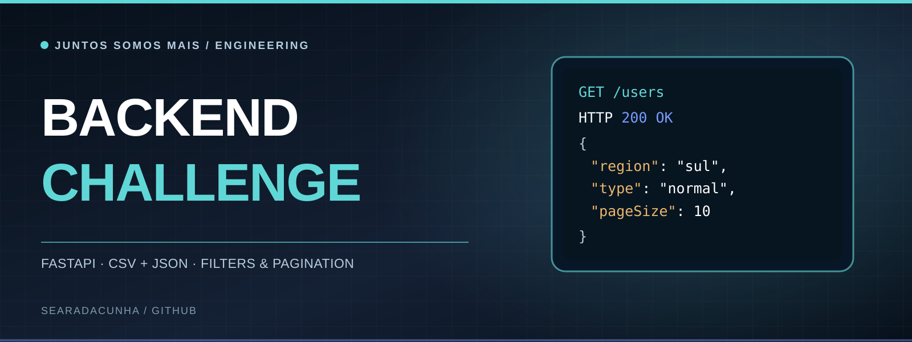

# Juntos Somos Mais backend challenge

<p align="center"></p>

A small REST API for the [Juntos Somos Mais backend challenge](https://github.com/juntossomosmais/backend-challenge).
At startup it downloads two customer files (one CSV, one JSON), applies the business
rules, keeps the result in memory and serves it with filters and pagination.

Python, FastAPI, httpx, pydantic. No database.

| Checked on the official data | Result |
|---|---|
| Customers loaded | 2000 records (1000 from the CSV, 1000 from the JSON), none rejected. The two files hold the same 1000 people (decision 3). |
| Official `validate.sh`, unchanged | `Response body is valid.` |
| Every served customer against a second implementation of the rules (`tools/verify_live.py`) | 2000 of 2000 identical, on both paths, with every filter |
| By type | 4 special, 4 normal, 1992 laborious |
| By region | norte 506, nordeste 660, centro-oeste 316, sudeste 306, sul 212 |
| Tests | 345, offline, under one second, 100 % line and branch coverage (CI fails below 100 %) |

## Run it

With Docker (Compose 2.24 or newer):

```bash
docker compose up --build
```

Without Docker (Python 3.12 or newer):

```bash
python -m venv .venv
source .venv/bin/activate
pip install -r requirements-dev.txt
uvicorn src.main:app --port 8080
```

Then, in another terminal:

```bash
./validate.sh                      # the script of the challenge: "Response body is valid."
python tools/verify_live.py        # every customer, both paths, every filter
curl "http://localhost:8080/users?region=sul&type=laborious&pageSize=2"
```

Interactive documentation is at <http://localhost:8080/docs>.

Tests and lint:

```bash
pytest --cov                       # offline: the two sources are replaced by a mock transport
ruff check . && ruff format --check .
```

## API

`GET /users` and `GET /api/v1/users` are one handler behind two paths. The README of
the challenge documents the first one, its `validate.sh` calls the second one.

| Parameter | Values | Default |
|---|---|---|
| `region` | `norte`, `nordeste`, `centro-oeste`, `sudeste`, `sul` | no filter |
| `type` | `special`, `normal`, `laborious` | no filter |
| `pageNumber` | integer, 1 or more | 1 |
| `pageSize` | integer, 1 to 100 | 10 |

```json
{
  "pageNumber": 1,
  "pageSize": 10,
  "totalCount": 2000,
  "users": [
    {
      "type": "laborious",
      "gender": "F",
      "name": { "title": "mrs", "first": "ione", "last": "da costa" },
      "location": {
        "region": "norte",
        "street": "8614 avenida vinícius de morais",
        "city": "ponta grossa",
        "state": "rondônia",
        "postcode": 97701,
        "coordinates": { "latitude": "-76.3253", "longitude": "137.9437" },
        "timezone": { "offset": "-1:00", "description": "Azores, Cape Verde Islands" }
      },
      "email": "ione.dacosta@example.com",
      "birthday": "1968-01-24T18:03:23Z",
      "registered": "2004-01-23T23:54:33Z",
      "telephoneNumbers": ["+550154155648"],
      "mobileNumbers": ["+551082645550"],
      "picture": {
        "large": "https://randomuser.me/api/portraits/women/46.jpg",
        "medium": "https://randomuser.me/api/portraits/med/women/46.jpg",
        "thumbnail": "https://randomuser.me/api/portraits/thumb/women/46.jpg"
      },
      "nationality": "BR"
    }
  ]
}
```

- `totalCount` is the number of customers that match the filters, not the size of
  the page.
- The order never changes: CSV rows first, then JSON records, each in file order.
  Walking the pages returns every customer exactly once.
- A page after the last one answers 200 with an empty `users` list.
- An invalid value answers 422 and names the parameter. So does an unknown parameter:
  `?pagesize=50` is an error, not a silent return to the default.
- `GET /health` answers `{"status":"ok","users":2000,"rejectedRecords":0}`. The
  server only accepts requests once both sources are loaded, so it is also a
  readiness check.

## Business rules as implemented

| Rule of the challenge | Implementation |
|---|---|
| Classification by bounding box | `src/classification.py`. Published labels, each axis sorted, edges inclusive, special before normal. Coordinates that are present but are not numbers, or are out of range, give laborious. |
| `phone`, `cell` to E.164 | `to_e164` in `src/transformers.py`. A format conversion: `+55` is added to a complete national number, a number that already has a calling code is kept, an incomplete one gives an empty list. No digit is added or removed. |
| `gender` | `male` or `m` gives `M`, `female` or `f` gives `F`, ignoring case and surrounding spaces. Anything else gives `null`. |
| `dob.age`, `registered.age` | Dropped. The two dates become `birthday` and `registered`, in UTC, to the second, with a `Z`. |
| `nationality` | `BR`. |
| `region` | Looked up from the state, ignoring case, accents and spacing. The state name itself is served as received. An unknown state gives `null`. |

A record that cannot fill the output contract (for example without coordinates, or
with a date that cannot be read) is rejected: counted, logged without its values,
reported by `/health`, never served. None of the official records is rejected.

Two things are done that the README does not ask for: surrounding spaces are removed
from text fields (1398 street values of the official files end with a space), and
the postcode is served as an integer, as the contract example shows.

## Decisions

The short version. The measurements and the alternatives are in
[docs/decisions.md](docs/decisions.md).

1. **The bounding boxes are ambiguous in two ways.** Every "minlon" is greater than
   its "maxlon": taken literally nobody is special or normal, so each axis is sorted.
   And the labels look transposed: as published the boxes lie in the South Atlantic,
   swapped they cover the Northeast, São Paulo and the South of Brazil. The published
   labels were kept because the README is the contract and the coordinates of the
   data set are random points that cannot settle the question. The other reading
   would give 8 special and 0 normal instead of 4 and 4. Switching is a one-line
   change, plus the tests that pin the current reading. It is the first question to
   ask the owner of the rule.
2. **Phones are converted, not validated.** Measured with libphonenumber: only 697 of
   the 2000 numbers of a file are valid Brazilian numbers, the README's own example
   is not one of them, and the library would rewrite 213 numbers by stripping what
   it reads as a national prefix (a leading 0, or 90). A small function converts the
   format and refuses to guess.
3. **The two files hold the same 1000 customers.** The validator expects 2000, so the
   merge is a concatenation. The total is never written in the code.
4. **All or nothing at startup.** If one source cannot be downloaded or parsed, or
   the CSV header lacks an expected column, the process exits with an error instead
   of serving the other half.
5. **One strict output contract.** A record that cannot fill it is rejected, counted,
   logged without its values and reported by `/health`.
6. **Nothing that was not asked for.** No database, cache, index, reload endpoint or
   retry loop.

## Layout

```
src/
  config.py             settings read from environment variables
  models.py             output contract and query string
  classification.py     rule 1: bounding boxes
  transformers.py       rule 2: phones, gender, region, one raw record to one customer
  loaders.py            download, CSV and JSON parsing
  service.py            startup load, in-memory store, filters and pagination
  main.py               application, lifespan, routes
tests/                  unit tests by module, API tests, shared builders (all offline)
tools/verify_live.py    second implementation of the rules, run against a live instance
docs/decisions.md       the choices and the evidence behind them
docs/references.md      documentation read and versions used
ai-journey/             how AI was used (required by the challenge)
validate.sh             the validator of the challenge, unchanged
Dockerfile, docker-compose.yml, .github/workflows/ci.yml
pyproject.toml          dependencies, pytest, coverage and ruff settings
requirements*.txt       every package pinned, generated from pyproject.toml
```

## Configuration

Every variable is optional. See `.env.example`.

| Variable | Default | Meaning |
|---|---|---|
| `CSV_URL` | the official CSV | first source, http or https |
| `JSON_URL` | the official JSON | second source, http or https |
| `HTTP_TIMEOUT_SECONDS` | `10` | timeout of each phase of a download (connect, read, write, pool) |
| `MAX_PAGE_SIZE` | `100` | largest `pageSize` accepted |
| `LOG_LEVEL` | `INFO` | `DEBUG`, `INFO`, `WARNING`, `ERROR` or `CRITICAL` |

A value that cannot be used stops the process at import time with an error that
names the variable, without repeating the value.

## Production notes

- **Image.** `python:3.14-slim`, pinned dependencies, non-root user, a `HEALTHCHECK`
  on `/health`, port 8080.
- **Logs.** One line per source at startup with its counts, and the reason for each
  of the first ten rejected records of a source. No customer data is logged, and
  neither is the path or query string of a source URL, where a signed URL keeps its
  secret. At `DEBUG`, httpcore still logs the host and port it connects to.
- **CI.** Two jobs run in parallel. One runs lint and tests on Python 3.12, 3.13 and
  3.14. The other builds the image, starts it against the real sources, runs the
  official `validate.sh`, checks the exact total on both paths, runs
  `tools/verify_live.py`, and starts two more containers whose CSV or JSON source is
  unreachable: both must exit with code 3, the second one after its CSV has loaded.
- **Dependencies.** `requirements.txt` and `requirements-dev.txt` are generated from
  `pyproject.toml` with `uv pip compile --universal` and pin every package.

## Known limits

- The data is loaded once. A change in the source files needs a restart.
- Phone numbers are not checked against the Brazilian numbering plan (decision 2).
- A download has a timeout per phase, but no overall deadline and no size limit. A
  server that sends a byte every few seconds can delay startup for a long time. The
  sources are set by whoever runs the service.
- The CSV header is checked, the JSON has no header. A key renamed in every JSON
  record would give `null` genders, regions or phones without rejecting anything.
- There is no rejection threshold. A source where most records are rejected still
  starts, with the count in `/health` and in the logs.
- The postcode is an integer because the contract says so. A real postcode starting
  with 0 would lose it.
- Two-letter state codes (`SP`, `RJ`) are not mapped to a region.
- The image is only built and run by CI. There is no Docker on the machine where the
  code was written.

## AI usage

This project was written with Claude Code, an AI coding agent, working from a
detailed brief given by the candidate. What it was asked, what it got wrong, what
was checked and what was not is in [ai-journey/](ai-journey/README.md).
